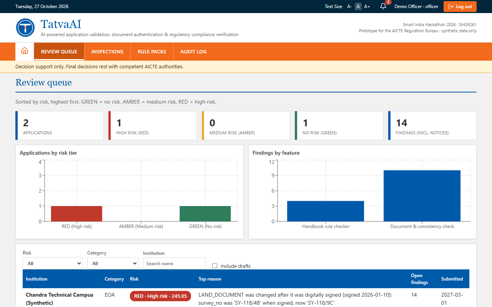
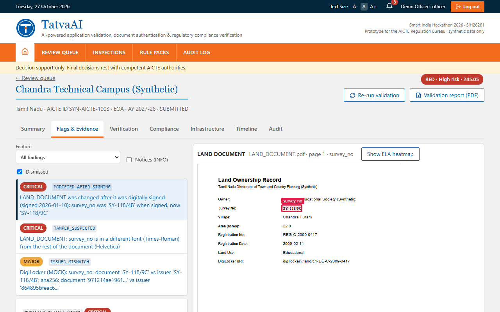
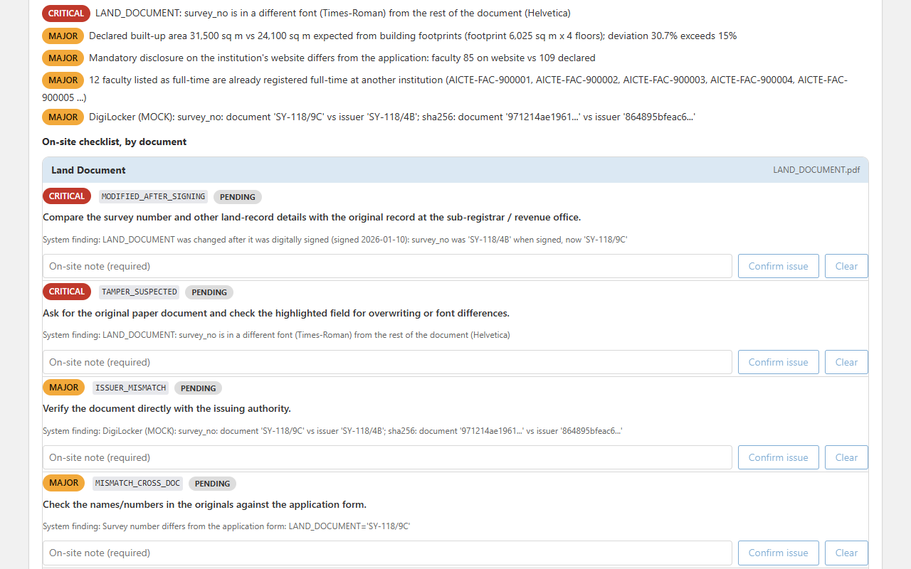

# TatvaAI

AI-assisted application validation, document authentication and compliance checking for AICTE approvals.
Built by Team Hexaminds for Smart India Hackathon 2026, problem statement **SIH26261** (AICTE Regulation Bureau).

> **Decision support only.** TatvaAI never approves or rejects anything. It raises flags backed by evidence, and an officer decides and writes a reason. All data in this repository is synthetic, and every external source (e-stamp, DigiLocker, state portals, AICTE records) is a clearly labelled mock.



## What it does

A college uploads its yearly application. TatvaAI reads the documents, checks them, and turns the findings into a risk tier so inspectors go where they are needed most.

1. **Handbook rule checker.** Faculty, rooms, computers, bandwidth, built-up area and certificate dates are checked against the AICTE Approval Process Handbook. Every flag cites its clause and page.
2. **Document and consistency check.** Is each document genuine, and do the facts agree across documents, years and colleges? It catches edits made after a digital signature, QR codes that disagree with the printed text, reused photos, and faculty listed full-time at two colleges.
3. **Risk ranking and officer review.** Each application is scored GREEN, AMBER or RED. The officer accepts or dismisses each flag with a written reason, and inspectors get a ranked list with an on-site checklist.



Supporting features: document classification and field extraction, issuer lookup (mock), reuse of last year's verified documents, editable course and intake settings, an evidence viewer, versioned rule packs with dry-run, a hash-chained audit log, a fix-list before submission, alerts, PDF reports, and optional two-factor login.

## Roles

| Role | What they do |
|---|---|
| College | Enters course and intake, uploads documents, runs a pre-check, fixes problems, submits. |
| Officer | Reviews the risk-ranked queue, inspects flags with their evidence, decides with a reason, manages rule packs, reads the audit log. |
| Inspector | Works through a ranked list of RED colleges using a per-document on-site checklist (confirm or clear each item with a note). |



## Tech stack

| Layer | Technology |
|---|---|
| Frontend | React, Vite, TypeScript, React Router, PDF.js, Leaflet, Recharts |
| Backend | FastAPI, SQLAlchemy, Alembic, Pydantic, PyJWT, pyotp, Celery and Redis |
| Verification | pyHanko (PDF signatures), PyMuPDF, OpenCV, imagehash, simpleeval (rule formulas) |
| Data | SQLite by default, PostgreSQL supported; rule packs are versioned YAML |

Optional and off by default: OCR for scanned pages, PC counting in lab photos, and a local model that drafts rules.

## Getting started

You need Python 3.11 or newer and Node.js 20 or newer.

```bash
# 1. Backend setup, synthetic data and database
python -m venv .venv
source .venv/bin/activate                 # Windows: .venv\Scripts\activate
pip install -r backend/requirements.txt
python scripts/seed.py --reset --inprocess-mock

# 2. Mock issuer service (terminal 1)
MOCK_DB=$PWD/data/synthetic/mock_db.json uvicorn main:app --app-dir mock_issuers --port 9000

# 3. API (terminal 2)
MOCK_ISSUERS_URL=http://127.0.0.1:9000 TRUST_ROOT_PATH=$PWD/data/synthetic/pki/ca.pem \
  uvicorn app.main:app --app-dir backend --port 8000

# 4. Web app (terminal 3)
cd frontend && npm install && npm run dev
```

Open http://localhost:5173. On Windows PowerShell, set variables with `$env:NAME = "value"` instead of the `NAME=value` prefix. A `docker-compose.yml` is also included.

### Demo accounts

The password for every account is `Tatva@2026`.

| Email | Role |
|---|---|
| `inst-a@tatva.test` | College, clean application (GREEN) |
| `inst-b@tatva.test` | College, left as a draft so you can pre-check and submit it (AMBER) |
| `inst-c@tatva.test` | College, many planted problems (RED) |
| `officer@tatva.test` | Officer |
| `inspector@tatva.test` | Inspector |

### The synthetic data

Three invented colleges show the range. **A** is clean. **B** has two problems (a fire certificate that expires before the academic year and a provisional occupancy certificate in its third year). **C** has many: a land record edited after it was signed, a QR code that disagrees with its certificate, twelve faculty already listed at another college, an inflated built-up area and a copied lab photo.

## Project structure

```
backend/        FastAPI app: API routers, the five checking engines, scoring, rule evaluator, models
frontend/       React web app for the three roles
rulepacks/      Handbook norms as versioned YAML, each rule with its clause and page
mock_issuers/   Simulated external systems (e-stamp, DigiLocker, UDIN, fire and occupancy portals, AICTE records)
scripts/        Seed data, synthetic data generator, evaluation and audit-tamper demo
tests/          Backend test suite
contracts/      Generated OpenAPI specification
```

## Tests

```bash
python -m pytest tests -q                 # backend
cd frontend && npm test                   # frontend
python scripts/verify_planted.py          # every planted problem is caught: A GREEN, B AMBER, C RED
```

The OpenAPI file is generated: `python backend/scripts/export_openapi.py`.
